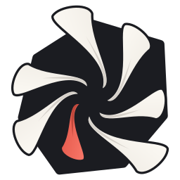

  

<h1 align="center">Persocord</h1>

  A fast, lightweight screen recorder and replay buffer for Windows, 
  made for getting clips into Discord in seconds.

  <a href="../../releases/latest"><b>⬇ Download the latest version</b></a> ·
  <a href="docs/GUIDE.md">Full guide</a> ·
  <a href="INSTALL.md">Install help</a>

---

## What it does

- **Replay buffer.** Keeps the last few minutes in the background (on the graphics card, out of your game's way). Press **Alt+F10** and the moment is saved.
- **Record an area.** **Ctrl+Shift+P**, drag over what you want, done. Pause, mic and PC sound toggles on a small bar beside it. GIFs too.
- **Sound on separate tracks.** PC audio, your mic and each app (game, Discord, browser…) get their own track, so you can switch any of them off later.
- **Built-in editor.** Trim, cut, speed, text, blur, crossfades, a multi-track timeline, and a 9:16 export for Shorts and TikTok.
- **Compress to a size.** Pick 10 MB (or any size) and it fits, for Discord's upload limit.
- **Share fast.** Copy the clip ready to paste, or upload it and get a link.
- **Your look.** Themes, accent colours and Windows 11 glass, shareable with friends as a code.
- **Made to run all day.** Light on memory, yields to games, and refreshes itself after long use while you're away.

Everything it can do, with every setting explained, is in the **[full guide](docs/GUIDE.md)**.

## Install

1. Download the zip from the **[latest release](../../releases/latest)** and extract it anywhere.
2. Double-click **Install Persocord.bat** inside the extracted folder.
3. Wait until it's done. The first time takes a few minutes, as it downloads what it needs by itself (.NET 8 and FFmpeg).
4. Persocord opens with a short setup. After that it lives in your tray.

**Updating:** when a new version is out, a bar at the top of the clip list says so. Press **Update** and Persocord installs it and opens again by itself. Your clips and settings are kept. (Running a newer **Install Persocord.bat** by hand works too.)

### Requirements

- Windows 10 or 11 (64-bit)
- Any graphics card from NVIDIA, AMD or Intel for the fastest recording; it also works on the CPU alone

## Default keys

| Action | Key |
|---|---|
| Record an area | `Ctrl+Shift+P` |
| Save the replay | `Alt+F10` |

Change them in **Settings → Hotkeys**.

## Something wrong?

Open **Settings → About → Diagnostics** and send the report along with what happened. It holds the details needed to track the problem down, and nothing personal.

## Building from source

Persocord is a .NET 8 WPF app (C#). **Install Persocord.bat** builds it from this source on your PC: it installs the .NET 8 SDK if missing, downloads the pinned FFmpeg 8.0.1 (checked by its fingerprint), and publishes the app. The source lives in [`src/Persocord`](src/Persocord), the install and build scripts in [`tools`](tools).

## License

© 2026 **dodorider** (Discord: **ruined**). Released under the **[PolyForm Noncommercial License 1.0.0](LICENSE.md)**.

- Free to use, change and share for anything non-commercial, as long as the license and its credit go with it.
- Selling it, or any commercial use, needs permission: ask dodorider on Discord.
- The Persocord name and logo stay dodorider's. A changed version needs its own name.

FFmpeg, the VLC engine and the other parts Persocord uses keep their own licenses: see [THIRD-PARTY-NOTICES.md](THIRD-PARTY-NOTICES.md).

Vibecoded by dodorider + Claude.

